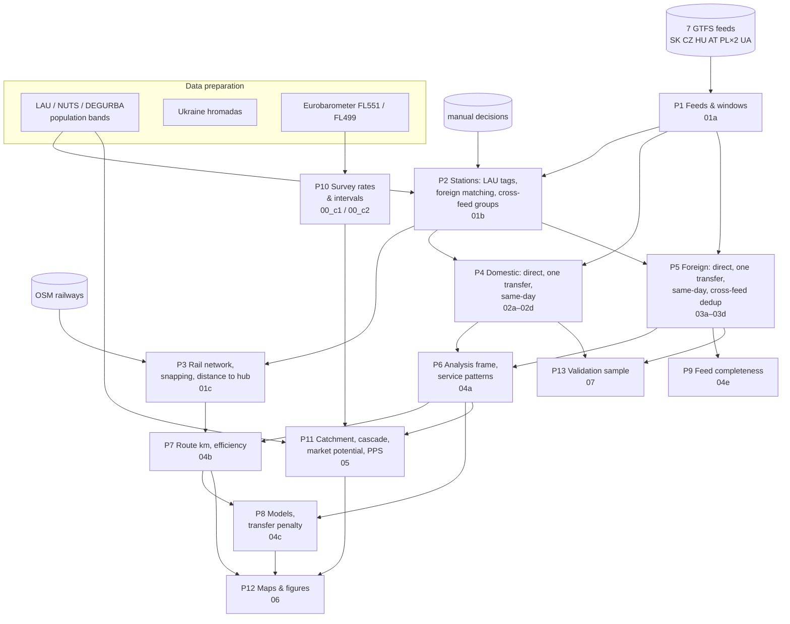

# traintranv2 — rail connectivity to a destination city from open timetables

**What this project computes.** Which municipalities in six central European countries (SK, CZ, HU, AT, PL, UA) can
reach a destination city by rail:
- with a **direct train** or with **one change of trains**;
- how often, how fast, on which days;
- whether a **same-day return** is possible;
- how many **rail travellers** live there.

Everything is built from independently published national GTFS timetables, harmonised into one network. The
destination is Košice (the study city); Bratislava is a second destination that shows the method transfers (§9).

**Where things are.**

| path | content |
|---|---|
| `traintranv2/` | the package: one module per notebook stage, plus `config.py` |
| `traintranv2/tests/` | unit tests (`pytest traintranv2/tests`) |
| `notebooks/01a … 07` | the analysis notebooks, run in order (jupytext-paired `.py` + `.ipynb`) |
| `notebooks/00_*`, `eb_*` | data preparation: population, LAU / NUTS layers, Ukraine, surveys |
| `notebooks/run_destination.py` | runs 01c–07 headless for a second destination |
| `data/feeds/` | GTFS snapshots + `feeds.manifest.json` (provenance) |
| `data/eu/`, `data/osm/`, `data/eb/` | reference layers (LAU, NUTS, DEGURBA, population), OSM railways, Eurobarometer microdata |
| `data/manual/` | human-reviewed decisions (station matches, groups, LAU corrections) and validation sheets |
| `output/<city>/` | every result: `output/kosice/`, `output/bratislava/` |

---

## 1. Running it

**Environment.** Python 3.11. The packages and pinned versions are in [`environment.yml`](environment.yml) (conda,
recommended) and [`requirements.txt`](requirements.txt) (pip):

```
conda env create -f environment.yml
conda activate traintranv2
python -m ipykernel install --user --name traintranv2 --display-name "Python (traintranv2)"
```

Open the notebooks with the kernel this registers. On a machine with PostGIS installed, see
[`docs/proj_lib_postgis.md`](docs/proj_lib_postgis.md): PostGIS's system-wide `PROJ_LIB` / `GDAL_DATA` clash with
the environment's own PROJ / GDAL. One environment covers every notebook, the tests and the
diagram build (Graphviz is included in the conda file; with pip, install Graphviz separately).

**No database is needed.**
- **Where the population comes from:** the 2025 population by age band is built in `00_b1`–`00_b5` from the
  statistical offices' own files and saved as `data/eu/ref-national-statistical-offices/<cc>/lau_population_2025_<cc>.csv`.
  `00_extract_base_data_eu` reads those files.
- **The optional database comparison:** each `00_b` notebook can also compare the result with an older 2021
  population table held in PostgreSQL (`TRAINTRAN_PG_URL`). That comparison is optional and feeds no output.

**Order.** Run the 00 preparation notebooks once (they build `data/`), then:

```
01a → 01b → 01c → 02a → 02b → 02c → 02d → 03a → 03b → 03c → 03d → 04a → 04b → 04c → 04e → 05 → 06 → 07
```

**Notebooks and code.** Each notebook is a thin narrative over its module in `traintranv2/`: the module does the
work, the notebook shows the checks and writes the outputs. Notebooks run from the project root. Every output file
gets a `.meta.md` beside it (schema, row definition, source, window), written by `nb01a_feeds.write_meta` from the
`SCHEMAS` registry.

**Destination.** `traintranv2/config.py` holds one profile per destination in `DESTINATIONS`, selected with
`TRAINTRAN_DESTINATION`. The default is `kosice`.

```
python -m pytest traintranv2/tests                                   # 129 tests
TRAINTRAN_DESTINATION=bratislava python notebooks/run_destination.py # 01c..07 for Bratislava
```

---

## 2. The pipeline at a glance

| # | stage | notebook / module | main inputs | main outputs |
|---|---|---|---|---|
| P0 | data preparation | `00_*`, `eb_*` | Eurostat LAU / NUTS / DEGURBA; national population tables of the statistical offices (Statistik Austria, ČSÚ, GUS, KSH, ŠÚ SR; Ukraine); ŠÚ SR tourism statistics for Košice; GESIS survey files | `data/eu/…` subsets with population bands; `data/eb/*.parquet`; Košice visitors by origin |
| P1 | feeds and windows | 01a · `nb01a_feeds` | 7 GTFS zips | `feeds.manifest.json`, `windows.json`, `feed_roles.csv` |
| P2 | stations: tags, matching, identity | 01b · `nb01b_stations` | feeds, LAU subset, manual decisions | `station_tags.csv`, `station_feed_matches.csv`, `station_group_links.csv` |
| P3 | rail network | 01c · `nb01c_rail_network` | OSM railways gpkg, station tags | `rail_graph.npz`, `station_rail_snap.csv`, `rail_network_*.csv` |
| P4 | domestic connections | 02a–02d · `nb02_connections` | ZSR_SK timetable, tags, windows | `domestic/` legs, itineraries, coverage, same-day |
| P5 | foreign connections | 03a–03d · `nb03_foreign` | ZSR_SK + national feeds | `foreign/` legs, itineraries, coverage, same-day, duplicates |
| P6 | analysis frame and service patterns | 04a · `nb04_frame`, `nb04_patterns` | P4 + P5 outputs | `explore/lau_table.csv`, `service_patterns.csv`, `coverage_curve.csv` |
| P7 | distance and efficiency | 04b · `nb04_distance` | rail graph, legs, itineraries | `efficiency_*.csv`, `route_validation.csv`, `detour_summary.csv` |
| P8 | statistical models and diagnostics | 04c · `nb04_models` | LAU table | `models_*.csv`, `correlations.csv`, `claims_audit.csv`, `specification_choice.csv`, `influential_observations.csv`, `spatial_diagnostics.csv`, `README_models.md` |
| P9 | feed completeness | 04e · `nb04_feeds` | feeds, P5 | `feed_table.csv`, `feed_effect.csv`, `dedup_radius.csv` |
| P10 | survey layer | 00_c1, 00_c2 | FL551, FL499 microdata | `data/eb/fl551_*.csv`, `fl499_*.csv` (rates, intervals, tests) |
| P11 | catchment and market | 05 · `nb05_catchment`, `nb05_market_potential` | LAU table, survey rates, PPS, car ownership | `catchment.csv`, `cascade.csv`, `market_potential_*.csv`, `pps_profile.csv` |
| P12 | maps and figures | 06 · `nb06_figures` | everything above | `explore/figures/F1–F7` (PNG + PDF) + `captions.md` |
| P13 | validation sample | 07 · `nb07_validation` | legs, itineraries | `validation_sample.csv`, `data/manual/validation_journeys*.csv` |

The overview below is the short form. **The full diagram** is [`docs/pipeline.svg`](docs/pipeline.svg) (also `.png`,
and [`docs/pipeline.md`](docs/pipeline.md) with its legend). It is read left to right, has right-angled edges and
no crossings, and every box lists the files it writes. Its source is `docs/pipeline.dot`, a fixed grid laid out
with Graphviz. `docs/pipeline.mmd` is a Mermaid text version with the same boxes and arrows. Rebuild everything
with `python docs/build_pipeline_docs.py`.



---

## 3. Stage by stage

### P0 — Data preparation (`notebooks/00_*`, `eb_*`)

| notebook | does |
|---|---|
| `00_extract_base_data_eu` | GISCO LAU 2024 and NUTS 2024 subsets for the six countries (GeoJSON), with population 2025 in three bands (0–14, 15–64, 65+) and DEGURBA |
| `00_b1 … 00_b5` | national population per municipality: AT, CZ, PL, HU, SK |
| `00_a_prep_ua_data`, `input_data_extension_ukraine` | the Ukrainian layer: 1,769 hromadas, population, area, GHSL-derived DEGURBA |
| `harmonize_population_lau2`, `download_urban_rural_datasets` | population harmonised to LAU; DEGURBA downloads |
| `eb_fl551_load`, `eb_fl499_load` | Eurobarometer microdata (GESIS ZA8901, ZA7807) to parquet, with region → NUTS crosswalks |
| `00_d1_slovakia_tourism_kosice` | Košice visitors and nights by origin (ŠÚ SR DATAcube) |

### P1 — Feeds and analysis windows (01a, `nb01a_feeds`)

- **The seven feeds:**

  | key | country | feed |
  |---|---|---|
  | `ZSR_SK` | SK | domestic |
  | `DRAHY_CZ` | CZ | |
  | `MAV_HU` | HU | |
  | `BAHN_AT` | AT | |
  | `PL_REG` | PL | PolishTrainsGTFS, all carriers except PKP-IC |
  | `PL_IC` | PL | PKP Intercity |
  | `UKRZ_UA` | UA | |

  URL, licence, version and snapshot notes are in `config._ALL_FEEDS`. `feed_manifest` writes file, size, SHA-256,
  the `feed_info` version and the calendar span to `data/feeds/feeds.manifest.json`.
- **Analysis window per feed:** from the actual service, not from the declared calendar: from the first to the last
  day with ≥ 50 % of the feed's median daily trains (`service_span`).
  - Foreign feeds use their **overlap with ZSR_SK**: CZ 364 days, HU 301, AT 276, UA 364, PL_REG 32, PL_IC 101.
  - Output: `windows.json`.
- `feed_roles.csv` (domestic / foreign, window); `feed_monthly_trains.csv` (trains per month, a completeness view).

### P2 — Stations: tagging, matching, cross-feed identity (01b, `nb01b_stations`)

- **Catalog:** stops used by rail trips. Bus-only stops (rail replacement, route_type 3 / 700–799) and excluded
  agencies (the Budapest Children's Railway; PKP-IC inside PL_REG) are dropped. Stops of one name and position are
  merged.
- **LAU tagging:** every station is placed in its LAU polygon.
  - For Slovak stations the name is also checked against the LAU name.
  - Human corrections come from `data/manual/lau_manual_matches_v2.csv`.
- **Foreign matching:** each ZSR_SK station abroad is matched to the national feed, in tiers:
  1. UIC code;
  2. exact name;
  3. core name (country tags and abbreviations stripped);
  4. sequence similarity ≥ 0.90.

  A name hit is accepted automatically only if it lies **in the same LAU and within 0.5 km**; otherwise it goes to
  review, with position candidates within 1 km. Reviewed decisions: `data/manual/station_feed_manual.csv`.
- **Cross-feed station groups** (`link_station_groups`): one `station_group_id` per physical station across feeds,
  linked by UIC code, matched names or the same place. Reviewed pairs: `data/manual/station_group_manual.csv`. Groups
  are the unit of transfers.
- **Name normalisation:** one normaliser (`nb01a_feeds.norm_name`) with stroked letters folded (ł ø đ ß æ).

### P3 — Rail network (01c, `nb01c_rail_network`)

- **Source:** the OSM railway extract `data/osm/v4_railways.gpkg` (manifest with extraction date). It keeps
  `railway ∈ {rail, narrow_gauge}`, plus the Tatra electric railway by ref / gauge, clipped to the six countries +
  5 km.
- **Graph:**
  - vertices on a 0.5 m grid;
  - dead ends joined to other components within 25 m;
  - stations linked to every component within 300 m;
  - cut-off pieces bridged over `construction` track (≤ 15 km);
  - stations farther than 2 km from any track get no rail distance.
- **Distances from the hub station** (`cfg.hub_stop_id`):
  - `rail_km`: the shortest track path, a lower bound;
  - `geo_km`: the straight line;
  - `detour` = rail / geo.

  Status per station: `ok`, `snap_too_far`, `other_component` or `outside_network`.
- **Network length:** track-km and line-km per country by the two-buffer method, L = (A₃₀ − A₁₅) / (2 · 15 m), which
  separates double track from line length.

### P4 — Domestic connections (02a–02d, `nb02_connections`)

- **Timetable** (`load_timetable`): trips running in the window, each with a **run-date bitmask** (one bit per day).
  - Times are service-day seconds, **never wrapped at 24 h**.
  - Austrian trains published in pieces are rejoined by train number (`join_train_pieces`).
  - Cached per feed and window in `output/<city>/timetable/`.
- **Hub:** `cfg.hub_station_keys` and every station grouped with them. **Hub city:** all its district LAUs form one
  unit (`cfg.city_units`), excluded from every catchment and denominator. The other split city (Bratislava or
  Košice) is also one unit.
- **Direct** (02a): every trip calling at the hub and at a station.
- **One transfer** (02b): a first train to a transfer station, then a second train to the hub (inbound; outbound is
  the reverse).
  - Same station group; connection 10–90 min.
  - **Paired per service date:** each first train takes the earliest connection running that day.
  - **Across midnight:** a second train after midnight connects on the next date (`next_day`, mask shifted one day).
  - The same train is never counted as a transfer.
  - Sensitivity grid: (10, 60) (15, 60) (20, 60) (20, 90) (20, 120) (30, 120).
- **Frequency:** for each distinct journey and LAU, run days in the window ÷ window days, so journeys per day.
  A journey serving several stations of one LAU counts once.
- **Same-day visit** (02c, 02d): on one date, an inbound option arriving **by 11:00** and an outbound option leaving
  **at or after 17:00**, at least **6 h** later, and **back by 23:59**. Reported as the share of the window's days.
  Dwell sensitivity: 4 / 6 / 8 h.
- **Gateway dependence:** which transfer stations carry the journeys of each newly reached LAU (`hubs_for_90`, sole
  gateways).

### P5 — Foreign connections (03a–03d, `nb03_foreign`)

- **One run per country** on its common window: CZ, HU, AT, UA, PL (PL_REG, 32 days); PL:PL_IC (101 days) is a
  sensitivity run.
- **The train that reaches the hub always comes from ZSR_SK.** The other leg comes from ZSR_SK or the national
  feed. Consequence: a train present only in a foreign feed is not seen.
- **Same train in two feeds** (`dedupe_cross_feed`): legs on the same station pair, departure and arrival within
  **2 min**, sharing a run date, count once; the national feed's copy is kept. Matched within 2-minute time buckets,
  one feed pair at a time (same result as a full join, bounded memory).
- **A foreign station's LAU** comes from the national feed's own stop (`station_lau`).
- **City-transfer sensitivity:** a transfer between two stations of the same LAU, 45–90 min.
- Same-day rules as P4.

### P6 — The analysis frame and service patterns (04a, `nb04_frame`, `nb04_patterns`)

- **`journeys`:** one row per distinct journey × LAU × direction, for all four networks (domestic / foreign ×
  direct / one transfer). It carries:
  - journey time and run days;
  - route km, rail km and geo km;
  - the feed of each train.
- **`lau_table`:** one row per LAU × network × direction × run. It carries:
  - journeys per day and mean journey time;
  - the three distances;
  - DEGURBA, population, population 15+, NUTS2 / NUTS3.
- **Service patterns:** journeys per day on each weekday, month and season, from the run masks. Each LAU is
  classified as every day / weekday only / weekend only / partial. Also produced: direction asymmetry, route types,
  NUTS hierarchy, and the coverage curve over frequency thresholds 1 / 2 / 5 per day.

### P7 — Distance and efficiency (04b, `nb04_distance`)

- **Route km:** the sum of the shortest track paths between **consecutive stops of the train**, i.e. the distance
  the train actually travels. Dijkstra is capped at 3 × geodesic + 20 km.
  - Validated against the operators' `shape_dist_traveled`: median ratio 1.002.
  - Missing where the track leaves the six-country network.
- **Efficiency** = journey time / distance (min/km), reported for route km (operating), rail km (access) and geodesic.
  Ratio-of-means, trip-weighted. Near-hub cut-off sensitivity: 0 / 3 / 5 / 10 km.

### P8 — Statistical models (04c, `nb04_models`)

- **Model families:**
  - distance decay (time ~ distance);
  - power models (log time, log frequency);
  - a joint log-frequency model with country effects;
  - a two-part model (binomial GLM for "served at all", OLS for frequency).
- **Transfer penalty Δα:** a pooled model with a transfer indicator, plus a matched comparison of the same LAU direct
  vs one transfer.
- **Reported for every fit:** HC3 standard errors and 95 % CIs, R², Breusch–Pagan, RESET, residual skew, Cook's D,
  and Moran's I (KNN 5).
- **Correlations:** Fisher-z and bootstrap intervals, pooled and within each country for the foreign networks, with a
  sign check against the pooled value (Simpson's paradox).
- **`claims_audit.csv`:** 21 previously published coefficients recomputed, each with its interval, plus whether the
  specification behind each one is rejected by RESET.

**Every diagnostic is answered, not only computed.** Each run states the reading in `explore/README_models.md`:
- **Country effects** (foreign networks):
  - `C(country)` fixed effects on every family, which move the estimate;
  - SEs clustered by country where ≥ 5 countries are pooled, which move the interval;
  - domestic models stay pooled (one country).
- **Functional form:** a quadratic curvature probe, and a primary form per model chosen by a fixed rule at RESET 0.01:
  linear → log–log → linear with a caveat (`specification_choice.csv`).
- **Influential observations:**
  - every LAU with Cook's D > 4/n named, with the leave-one-out change in intercept and slope
    (`influential_observations.csv`);
  - a refit without the five most influential LAUs;
  - `n_removed` on every refit.

  Influential LAUs are never dropped from the headline fits.
- **Spatial autocorrelation:**
  - Moran's I of the outcome **and** of the residuals at k = 3, 5, 8, 10; their difference is the structure the
    covariates absorbed (`spatial_diagnostics.csv`);
  - `si_understated` flags models whose intervals are too narrow;
  - spatial lag / error models (`spreg`, ML) check whether the OLS coefficients move.

### P9 — Feed completeness (04e, `nb04_feeds`)

- **`feed_table`:** agencies, routes, trips, stops, stations, calendar exceptions and route types.
- **`feed_effect`:** what each national feed adds, comparing a ZSR_SK-only run with ZSR_SK + the national feed per
  country.
- **`dedup_radius`:** station counts at merge radii of 0.5 / 1 / 2 / 5 km.

### P10 — Survey layer (00_c2 for FL551, 00_c1 for FL499)

- **FL551** (non-probability quota sample, `w1` weight; intervals are **nominal**):
  - **T1 rail-market rate** = travels for leisure ≥ 50 km at least once or twice a year **and** used the train.
    Computed per country and per age band (15–64, 65+).
  - **T2 | T1:** combines rail legs of different operators.
  - Planning factors (Q3); upper-bound check against FL499; Slovak regional weighting check; regional cells with
    tests (§7c).
- **FL499** (probability sample): destination criteria (Q4), nationally and by region (§5c).
- **Regional cells:** NUTS2, Poland NUTS1. Each country gets a Wald test of one common rate, plus a top–bottom
  contrast with a Bonferroni correction. **No regional contrast is supported, so the paper uses national rates.**
- FL551 and FL499 are **never pooled**.

### P11 — Catchment, rail market, market potential (05, `nb05_catchment`, `nb05_market_potential`)

- **Catchment:** one row per LAU reachable inbound, with its service level (direct / one-hop), journey time and
  distances.
- **Mass levels:**
  - M1 = population 15+;
  - **M2** = population by age band × FL551 rate by age band;
  - M3 = M2 × (T2 | T1) for the one-hop layer.

  The conversion applies **beyond 50 km rail distance only**; the inner ring stays unconverted.
- **Cascade (Slovakia):** residents → with a rail connection → same-day return possible → rail travellers.
- **Market potential:**
  - contour, the primary measure: Σ M within journey time τ;
  - exponential, with half-life h on a grid.
- **Uncertainty:** rate intervals are perfectly correlated across municipalities, so a total's relative interval
  equals the rate's. The half-life is a grid, not an interval. The DEGURBA corners (city / town / rural propensity
  ratios 1.2 / 1 / 0.8 and 0.8 / 1 / 1.2) are normalised to the national mix.
- **Characteristics, never weights:** purchasing power (PPS, NUTS3) and car ownership (Eurostat `tran_r_vehst`,
  NUTS2).

### P12 — Maps and figures (06, `nb06_figures`)

- **One style for every figure:** shared fonts, network colours, class breaks, scale bar and country labels. Each
  figure is a 300 dpi PNG + PDF with a self-contained caption in `captions.md`.

  | figure | content |
  |---|---|
  | F1 | key map |
  | F2 | pipeline diagram |
  | F3 | journeys per day |
  | F4 | same-day share |
  | F5 | rail market (M2) |
  | F6 | chart grid (time, efficiency, frequency) |
  | F7 | coverage curve (drawn in 05 as `coverage_curve_by_country.png`, captioned in 06) |

### P13 — Validation sample (07, `nb07_validation`)

- **The sample:** stratified, inbound, one journey per LAU, fixed seed. Strata are country / feed run × direct /
  one transfer, plus cross-feed transfers and connections across midnight.
- **Dates:** upcoming only (2026-11-17 … 2026-12-12). Feeds whose window ended earlier (HU, PL) use the same weekday
  projected forward, only for a train that ran on ≥ 80 % of those weekdays.
- **The sheet:** `data/manual/validation_journeys*.csv` gets the planner's answer: match yes / partly / no, and the
  time difference. A sheet with answers is never overwritten. `score` gives match rates per stratum.

---

## 4. Modules (`traintranv2/`)

| module | stage | key functions |
|---|---|---|
| `config.py` | all | `RunConfig`, `default_config(destination)`, `DESTINATIONS`, `_ALL_FEEDS` |
| `nb01a_feeds.py` | P1 + shared helpers | `feed_manifest`, `pair_windows`, `service_span`, `feed_roles`, `shared_inputs`, `norm_name`, `write_meta`, `SCHEMAS` |
| `nb01b_stations.py` | P2 | `load_lau_subset`, `tag_feed_stops`, `build_station_catalog`, `match_foreign_stations`, `link_station_groups`, `uic_code`, `name_dedup` |
| `nb01c_rail_network.py` | P3 | `load_rail_ways`, `build_graph`, `join_gaps`, `snap_stations`, `bridge_components`, `distances_to_hub`, `track_and_line_km`, `RailGraph` |
| `nb02_connections.py` | P4 (engine for P4 + P5) | `load_timetable`, `join_train_pieces`, `direct_legs`, `one_transfer`, `daytrip_days`, `summarise`, `hub_dependence`, `hub_groups`, `lau_with_city_units`, `tags_with_city_units`, `hub_city_laus` |
| `nb03_foreign.py` | P5 | `country_runs`, `load_run_timetables`, `run_direct`, `run_one_transfer`, `first_legs`, `second_legs`, `dedupe_cross_feed`, `drop_same_train` |
| `nb04_frame.py` | P6 | `journeys`, `lau_attributes`, `lau_table` |
| `nb04_patterns.py` | P6 | `day_counts`, `lau_patterns`, `classify`, `coverage_curve` |
| `nb04_distance.py` | P7 | `pair_km`, `trip_cum_km`, `route_km_direct`, `route_km_itins`, `published_pairs` |
| `nb04_models.py` | P8 | `fit` (HC3 or clustered), `correlations`, `transfer_penalty`, `two_part`, `curvature`, `choose_form`, `influence_table`, `moran_pair`, `spatial_check`, `AUDIT_CLAIMS` |
| `nb04_feeds.py` | P9 | `feed_table`, `feed_effect`, `dedup_radius` |
| `nb05_catchment.py` | P11 | `catchment`, `load_rates`, `mass_levels`, `pps_table` |
| `nb05_market_potential.py` | P11 | `contour`, `exponential`, `degurba_corners`, `pps_profile`, `car_profile` |
| `nb06_figures.py` | P12 | `STYLE`, `BREAKS`, `choropleth`, `scale_bar`, `save`, `Captions` |
| `nb07_validation.py` | P13 | `train_numbers`, `sample`, `recording_sheet`, `score` |

The survey notebooks 00_c1 / 00_c2 use the survey helpers in `traintran/eurobarometer.py` (weighted shares, Kish
effective n, intervals, crosswalks) and write their exports with `traintran/output.py`.

---

## 5. Key parameters (`RunConfig`)

| parameter | value | meaning |
|---|---|---|
| `min_connect_min`, `max_connect_min` | 10, 90 | transfer window, minutes |
| `sensitivity_grid` | (10,60) … (30,120) | transfer-window sweep |
| `window_min_share` | 0.5 | a window day needs ≥ 50 % of the median daily trains |
| `daytrip_max_arrival`, `daytrip_min_departure`, `daytrip_max_return` | 11:00, 17:00, 23:59 | same-day rule |
| `daytrip_min_dwell_min` (+ sensitivity) | 360 (240, 480) | minimum stay, minutes |
| `match_auto_max_km`, `match_candidate_km` | 0.5, 1.0 | automatic foreign match / review candidates |
| `fuzzy_threshold` | 0.90 | name-sequence similarity |
| `rail_snap_max_km`, `rail_station_link_m`, `rail_gap_join_m` | 2.0, 300, 25 | network snapping |
| `city_units`, `hub_city` | Košice, Bratislava | districts merged into one unit; the hub city is excluded |
| cross-feed duplicate tolerance | 2 min | `dedupe_cross_feed(tol_s=120)` |

---

## 6. Outputs (`output/<city>/`)

Every file has a `.meta.md` with its columns, row definition, sources and window.

**Root (P1–P3).**
- `windows.json`, `feed_roles.csv`, `feed_monthly_trains.csv`;
- `station_tags.csv` (one row per station: feed, LAU, NUTS, DEGURBA, group);
- `station_feed_matches.csv` (+ review);
- `station_group_links.csv` (+ conflicts, review);
- `feed_stop_tags.parquet`;
- `rail_graph.npz`, `station_rail_snap.csv`;
- `rail_network_{ways, cleaning, components, bridges, added_edges, length}.csv`;
- `timetable/` (cache).

**`domestic/` (P4).**
- `direct_legs.parquet`, `one_transfer_itins.parquet`: every leg and itinerary with its run mask;
- `{direct, one_transfer}_{station, lau, coverage}.csv`;
- `one_transfer_hubs.csv`, `one_transfer_sensitivity.csv`;
- `daytrip_{direct, one_transfer}_{station, lau, coverage, sensitivity}.csv`.

**`foreign/` (P5).** The same set per country run, plus `cross_feed_duplicates.csv` and `feed_quality.csv`.

**`explore/` (P6–P13).**

| group | files |
|---|---|
| frame | `journeys.parquet`, `lau_table.csv`, `route_km_*.parquet` (cache) |
| patterns | `service_patterns.csv`, `direction_asymmetry.csv`, `route_types.csv`, `hierarchy.csv`, `coverage_curve.csv` |
| distance | `efficiency_lau.csv`, `efficiency_summary.csv`, `detour_summary.csv`, `route_validation.csv` |
| models | `models_coef.csv`, `models_summary.csv`, `correlations.csv`, `country_residuals.csv`, `claims_audit.csv`, `specification_choice.csv`, `influential_observations.csv`, `spatial_diagnostics.csv`, `README_models.md` (the written reading of the diagnostics) |
| feeds | `feed_table.csv`, `feed_effect.csv`, `dedup_radius.csv`, `dedup_changes.csv` |
| market | `catchment.csv`, `cascade.csv`, `market_potential_contour.csv`, `market_potential_exp.csv`, `degurba_corners.csv`, `pps_profile.csv`, `pps_bands.csv`, `car_profile.csv` |
| validation | `validation_sample.csv` |
| figures | `figures/F1…F6.{png,pdf}`, `figures/coverage_curve_by_country.png` (F7), `figures/captions.md` |
| second destination | `destination_comparison.csv` (Bratislava only) |

**Survey outputs (`data/eb/`).**
- `fl551_conversion_national.csv`: the rates the catchment joins to;
- `fl551_conversion_age6.csv`, `fl551_connecting_national.csv`, `fl551_planning_factors.csv`,
  `fl551_q14_reasons.csv`, `fl551_multimodal.csv`;
- `fl551_upper_bound_check.csv`, `fl551_sk_regional_weighting.csv`, `fl551_regional*.csv`;
- `fl499_*_national.csv`, `fl499_criteria_regional*.csv`.

---

## 7. Human-reviewed inputs (`data/manual/`)

| file | decisions |
|---|---|
| `station_feed_manual.csv` | accept / reject a ZSR_SK station's match in a foreign feed |
| `station_group_manual.csv` | accept / reject two stops of different feeds as one station |
| `lau_manual_matches_v2.csv` | a station's LAU where the automatic tag is wrong |
| `validation_journeys.csv`, `validation_journeys_bratislava.csv` | the planner check (P13) |

Notebooks never overwrite a decision already made. They only add new cases to review.

---

## 8. Method decisions a user should know

1. **Windows come from actual service**, not from declared calendars. Late snapshots keep a calendar while dropping
   services already run.
2. **Dated run masks everywhere.** Two legs connect only on dates when both run; no 24 h wrap; connections across
   midnight use the next date.
3. **Station identity across feeds** is by station group, built from UIC codes, names and positions plus reviewed
   decisions. Transfers happen within one group.
4. **City units:** split cities count as one unit, and the hub city is excluded from every denominator.
5. **The train reaching the hub comes from the domestic feed** (ZSR_SK). This is a known limit for trains published
   only abroad.
6. **A train counts once:** cross-feed duplicates (2 min), the same train as both legs, and Austrian train pieces are
   all resolved.
7. **Three distances:** route km (the train's path) for efficiency and decay; rail km (shortest track) for access and
   the 50 km survey floor; geodesic for reference.
8. **Survey rates are national, nominal and an upper bound** (FL551 is a quota panel with fewer never-travellers than
   the probability sample). They are applied by age band to population 15+, beyond 50 km only.
9. **PPS and car ownership describe the catchment and are never weights.** Weighting would double-count income, and
   both are regional.

---

## 9. A second destination

`DESTINATIONS` in `config.py` defines a destination:
- hub stations and hub city;
- display label and NUTS3 of the hub;
- validation sheet;
- visitors-by-origin file (if any).

`run_destination.py` does the rest:
1. copies the destination-independent P1–P2 outputs from `output/kosice/`, recording SHA-256 values in
   `SHARED_INPUTS.md`;
2. runs 01c–07 into `output/<city>/`;
3. skips the cells that apply to Košice only;
4. saves the executed notebooks to `notebooks/runs/<city>/`.

**Bratislava**:
- Hub stations: hl.st. + Petržalka + Nové Mesto, the stations where trains into the city end. All 682 ZSR trips
  reaching Bratislava call at one of them.
- See `output/bratislava/README.md` and `explore/destination_comparison.csv`.

To add a city:
1. add a profile to `DESTINATIONS`;
2. add its districts to `city_units` if it is split into district LAUs;
3. run `TRAINTRAN_DESTINATION=<name> python notebooks/run_destination.py`.

---

## 10. Status and provenance

- **Feed provenance:** `data/feeds/feeds.manifest.json`. **OSM provenance:** `data/osm/v4_railways.manifest.json`.
  **Eurostat car-ownership provenance:** `data/eu/eurostat/*.manifest.json`.
- **Survey microdata** (GESIS) cannot be redistributed: cite ZA8901 (doi:10.4232/1.14506) and ZA7807
  (doi:10.4232/1.13878) and ship the loaders.
